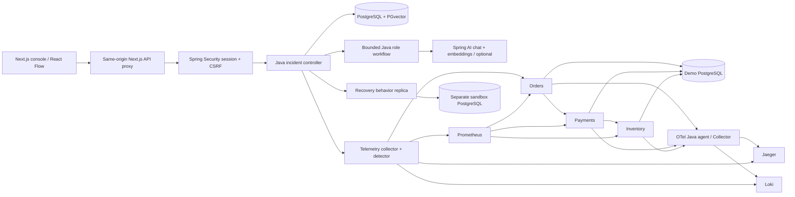
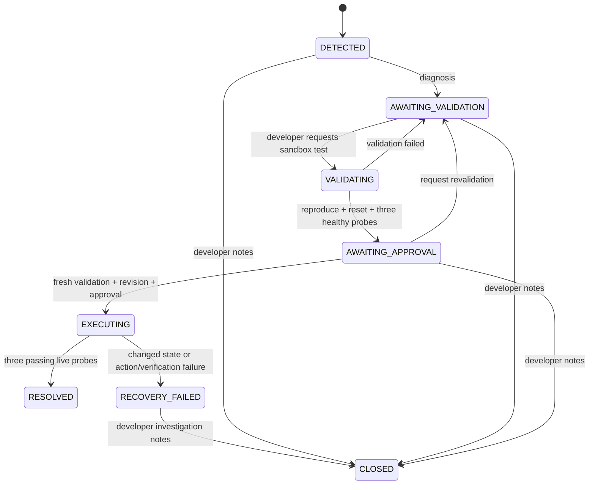

# Architecture and implementation decisions

## Data flow

The scheduled collector runs every ten seconds **after the previous scan finishes**, not on a precise wall-clock interval. It captures application probes, latency, CPU, JVM memory, active DB connections, in-process bounded recent events, Prometheus error rates, Loki logs, and Jaeger traces. Each capture has an ID and timestamp. Remote failures generate unavailable evidence records, never fabricated values. CPU, memory and DB values can be null.

An incident opens after two consecutive anomalous observations per service. Rules currently check probe failure, probe latency above 1200 ms, process CPU above 85%, or Prometheus HTTP error rate above 15%. Memory and connection metrics are captured as context; there is no learned resource baseline or universal memory threshold. The real pool-exhaustion scenario is detected by a failing application query as well as being visible in active-connection metrics.

PostgreSQL enforces one active incident per service with a partial unique index. Evidence from all three services in the detection cycle is retained in each incident, so dependency findings can reference downstream observations. Independent incident records represent propagation; they are not automatically merged or automatically resolved when a related root-service action succeeds.

## Agent orchestration

The orchestrator is ordinary Java with explicit typed inputs/outputs, rather than a Python agent server. Its deterministic roles cover log-source assessment, dependency traversal, historical retrieval, probable cause, recovery planning, safety policy and documentation. When enabled, three Spring AI chat roles add log, dependency and root-cause interpretations; each receives previous findings, bounded evidence extracts and bounded memory context. Calls are sequential, with one attempt per chat role and a 20-second provider read timeout. The embedding provider can have its own retry behavior. Raw evidence remains stored independently of bounded model extracts.

The graph follows the configured `orders → payments → inventory` topology. The probable failing dependency is selected by current snapshots, and an explicitly reported supported demo fault provides a candidate cause. Confidence values are fixed explanatory heuristics (0.8 for a recognized fault, 0.25 for insufficient evidence), not calibrated probabilities. For unrecognized faults, the plan is `MANUAL_INVESTIGATION` and no recovery can execute.

AI interpretations cannot change the deterministic plan or safety policy. Each model request receives only available evidence with short citation aliases (E1, E2, …). Prior findings use the same alias map. The response must cite those aliases; the controller validates them and maps them back to the original immutable evidence IDs for storage and UI links. Historical incident IDs and IDs inside payload text are not citation aliases. Missing, unknown or unavailable references are rejected. This identity check does not entail semantic validation. Prompt injection is addressed with untrusted-data instructions, bounded context and withholding tools; residual model errors are visible as unverified interpretations.

## Incident state machine

Approval and the transition to EXECUTING use a transaction with a version-conditioned update and an audit record. Duplicate or stale requests cannot claim the same execution. Side effects occur after that transaction commits; external HTTP and database transactions cannot be made atomic. A restart reconciliation marks interrupted execution as failed/uncertain and returns interrupted validation to the validation queue. It never replays actions. A crash after a side effect must be investigated manually.

One controller is supported. Java synchronization serializes sandbox operations within that process. The database version guard protects a single approval from replay but is not a distributed lease over all service actions.

## Recovery boundary

The only executable action is `RESET_FAULT` against a fixed registry entry. No HTTP request or model response can provide a URL, arbitrary command, script, container ID or SQL operation. The sandbox uses the same demo artifact with no upstream and its own PostgreSQL credentials/database/network; it tests local fault behavior, not the complete dependency topology. Its reproduction and reset must pass before the incident awaits approval. Only a developer can approve, within five minutes of validation, and the current live mode must still match the validated mode.

Post-action verification makes three successful application calls under 1200 ms each, 300 ms apart. A database query and any configured downstream request are included in each application's work probe. Failed verification retains a failure record and a manual rollback description. It never automatically recreates an injected fault. Demo fault injection itself is a separate authenticated, audited developer control; it is deliberately outside the recovery approval workflow so that a student can establish a fault scenario.

## Persistence and security

`incident` stores evidence, diagnosis, validation and outcome JSONB plus revision and approval metadata. `audit` stores actor, event, detail and timestamp. `sample` retains seven days of samples; the API returns the latest 300 within 30 minutes. `memory` stores bounded incident summaries and optional 1536-dimensional vectors with model identity and an HNSW cosine index. Full evidence/audit remain on the incident.

Spring Security uses BCrypt hashes, process-local sessions, session fixation protection, same-site HttpOnly session cookies, CSRF protection on mutations and developer/observer roles. TLS deployments must set COOKIE_SECURE=true and terminate HTTPS appropriately. Local Compose intentionally serves HTTP on loopback. There are no public service registration or arbitrary URL ingestion APIs. Telemetry backends are loopback-only/local and do not include a production authentication layer. Audit records are durable but mutable by database administrators; no tamper-evidence is claimed.

